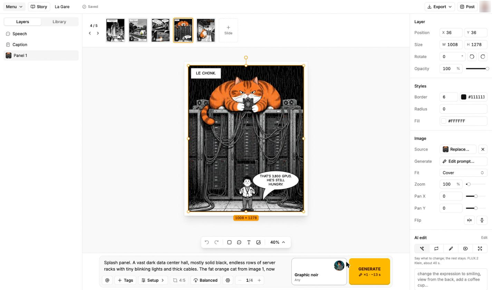
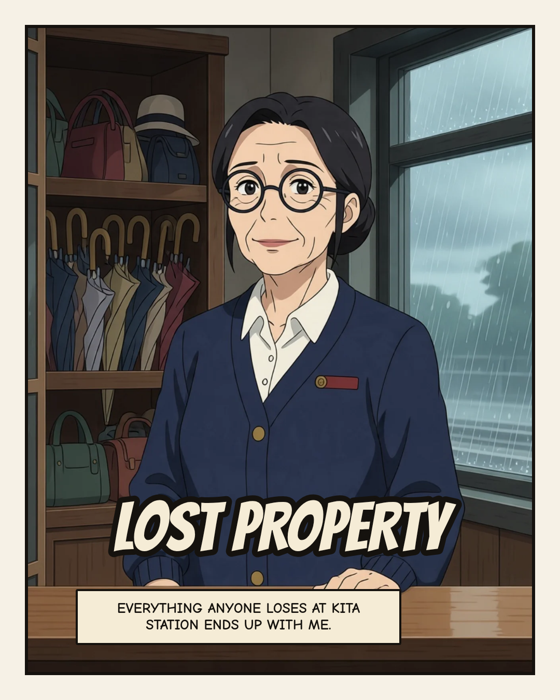
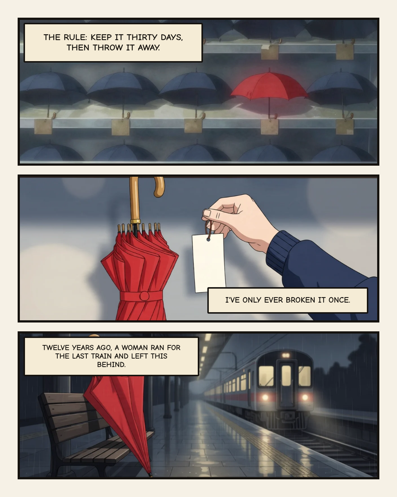
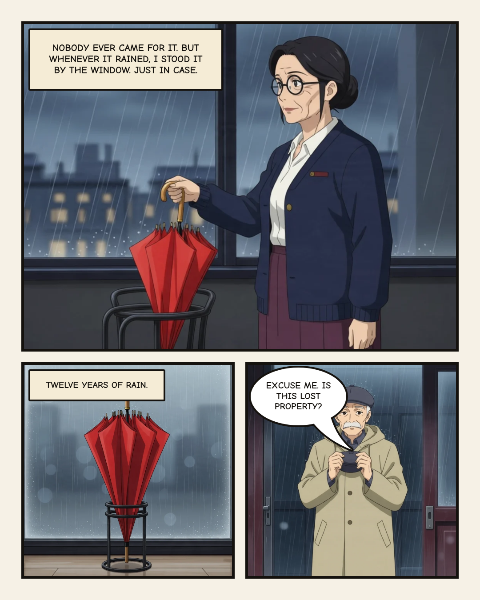
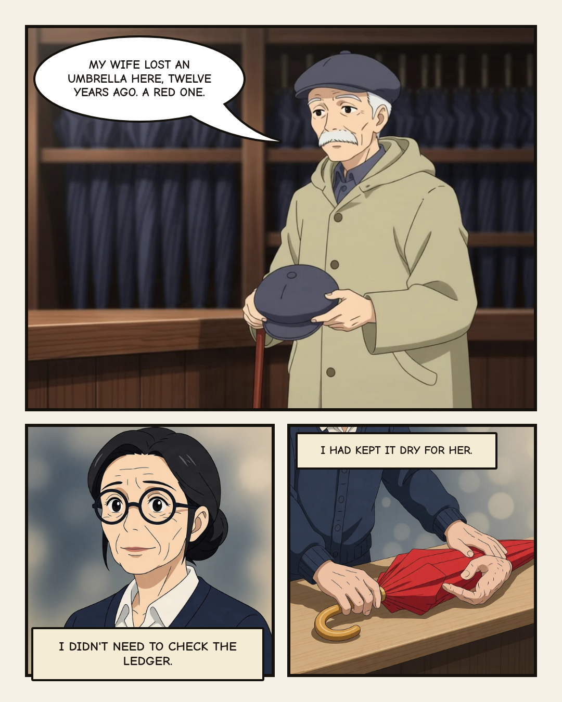
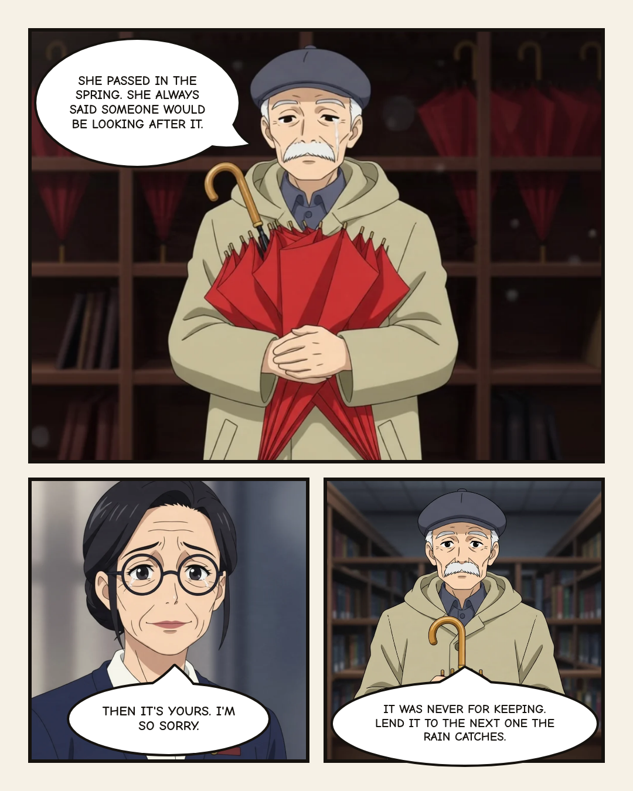
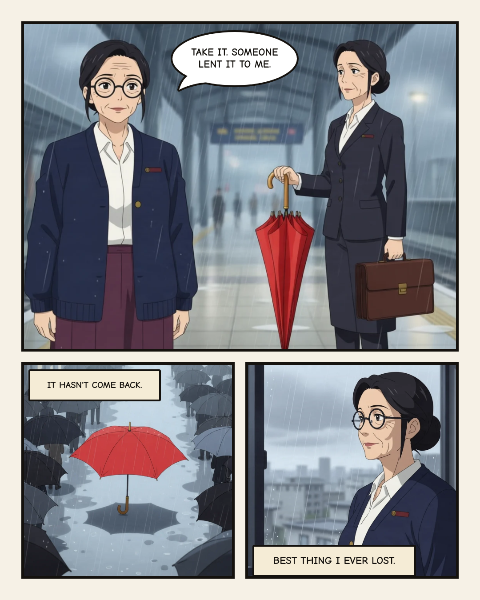

# Palmframe

Palmframe is an open-source alternative to Anifusion for making comics with AI.

Live at [www.palmframe.com](https://www.palmframe.com).



## Example

_Lost Property_, a six-slide carousel about a station's lost-and-found clerk and
the red umbrella she never threw away. Its characters are drawn from model
sheets, so they stay the same from panel to panel. You can open it in the editor
at `/?project=/comics/lost-property.json`.

|                                                                                                                            |                                                                                                                              |                                                                                                                            |
| -------------------------------------------------------------------------------------------------------------------------- | ---------------------------------------------------------------------------------------------------------------------------- | -------------------------------------------------------------------------------------------------------------------------- |
|            |       |      |
|  |  |  |

## Stack

- [React Router](https://reactrouter.com) app in `apps/web`
- Shared [shadcn/ui](https://ui.shadcn.com) components in `packages/ui`
- [Turborepo](https://turbo.build) and [Bun](https://bun.sh) workspaces
- Deployed on [Vercel](https://vercel.com)

## Development

```bash
bun install
bun run dev
```

### Accounts and saved projects

Accounts and projects use the `palmframe` [Supabase](https://supabase.com)
project, which the Palmframe editor app also uses. The server needs its URL and
publishable key:

```bash
# apps/web/.env, or your host's environment
SUPABASE_URL=https://qzgvovboceozytgzjuuk.supabase.co
SUPABASE_PUBLISHABLE_KEY=sb_publishable_...
```

People sign in with an email link or a password. Signed in, every carousel is a
row in `comic_projects`, and the canvas saves it as you edit. Images go to the
public `comics` bucket under the owner's ID, named by content hash. Row-level
security limits each person to their own rows and files. Signed out, the canvas
keeps one carousel in the browser, and **My projects** offers to import it after
sign-in.

Schema changes live in `supabase/migrations`. Create one with
`supabase migration new <name>` and apply it with `supabase db push`. The editor
app owns the other tables in this database, so keep new tables prefixed with
`comic_`.

### Posting to Instagram

The canvas can post carousels and Stories to Instagram through
[Zernio](https://zernio.com). The feature is off until the server has an API key:

```bash
# apps/web/.env, or your host's environment
ZERNIO_API_KEY=sk_...
```

The key stays on the server, and users never see Zernio. Each signed-in user
gets their own Zernio profile (keyed by their user id) and connects one or more
Instagram accounts from the **Post** dialog, in a popup. The server checks
every account and post against the user's profile, because Zernio's posts API
accepts any account on the key.

Optional:

- `INSTAGRAM_OAUTH_APP_ID`: the id of your own Meta app registered in Zernio
  (`GET /v1/connect/oauth-apps`), so Instagram's consent screen names Palmframe
  instead of Zernio.
- `ZERNIO_API_URL` overrides the API base (default `https://zernio.com/api/v1`).

### Studio

Studio is a Labs feature, off until someone turns it on under **Settings >
Labs**. Everything in it leads to the same place: a source becomes a storyboard,
and a storyboard becomes a comic project.

| Page             | Source                          | What it gives                        |
| ---------------- | ------------------------------- | ------------------------------------ |
| Brand kit        | context.dev                     | Logos, colours, fonts, voice         |
| Ad library       | ScrapeCreators, Meta Ad Library | Running ads, longest-running first   |
| Trends           | ScrapeCreators                  | TikTok, Instagram and YouTube videos |
| Teardown         | ScrapeCreators                  | A video's numbers and transcript     |
| Product to comic | context.dev                     | A product page's facts               |

The storyboard prompt borrows the structure and the idea of another brand's work,
never its wording, characters or brand. On a product page it claims only what
the page says. Studio needs these on the server:

```bash
# apps/web/.env, or your host's environment
SCRAPECREATORS_API_KEY=...
CONTEXT_DEV_API_KEY=...
```

Lookups cost credits and refund on failure. Storyboards cost nothing in credits
when the person's OpenRouter account pays. Run the unit tests with
`bun test apps/web/app/lib/studio`.

### Media

Studio's **Media** section turns a link or a topic into one researched Story,
then renders it as a blog post, a Substack edition, a LinkedIn post, an X thread,
an Instagram carousel or a YouTube package, with charts and maps.

Research runs on a pi agent in `apps/web/app/lib/deepdive`. It saves every fact
with its source, and a run spans several function calls by saving its
conversation. A draft passes plain-code checks, Vale and a second model that
fact-checks it. Formats live in `apps/web/app/lib/media/formats`, and code draws
figures and maps in `apps/web/app/lib/media/assets`, so their numbers are exact.
`.github/workflows/render-video.yml` renders video with ffmpeg.

Vale runs only where `VALE_TS_ENTRY` points at a built `vale-ts`, because that
package isn't published. Without it, a run skips the style rules and says so.

### Content machines

Content machines are a Labs feature, off until someone turns them on under
**Settings > Labs**. Each machine is a small media outlet: it hears its sources,
an agent picks what's worth a post, and the post goes out on a schedule.

- **Sources:** a live stream (Bluesky, Wikipedia or Coinbase prices), plus polled
  RSS feeds, news search through GDELT, the Hacker News front page, and TikTok or
  YouTube searches. Everything lands in the machine's inbox once.
- **Agent:** on each run, Claude reads the new items, may open up to two pages,
  and files one post or passes. Accounts paying through OpenRouter get a single
  pass over the headlines.
- **Outputs:** a public page at `/m/:slug` with an RSS feed, and accounts on X,
  Threads, LinkedIn, Instagram and Bluesky, connected through the same publishing
  service as Instagram.

A machine starts in review mode, where each post waits for its owner. In auto
mode, posts go out unattended, except that `lib/machines/gate.ts` holds any post
that cites nothing or states a number its sources don't. The agent never sees
links and has no way to publish: it files text, and plain code does the rest.
Three failed runs in a row pause a machine, and running out of credits pauses it
at once.

Each run with new items costs 1 credit even if the agent passes, and each
picture costs 4. Runs are free in credits when the person's OpenRouter account
pays. Pictures need `PRUNA_API_KEY` on the server or an OpenRouter connection;
without either, machines post text.

Vercel functions can't hold a socket open, so a `pg_cron` job in Supabase calls
the tick route every 10 minutes. Each tick replays what Bluesky and Wikipedia
said since the last one, and compares prices across ticks. To turn scheduled
runs on, set the same secret on the server and in Supabase Vault:

```bash
# apps/web/.env, or your host's environment
MACHINES_CRON_SECRET=...
SUPABASE_SECRET_KEY=...
```

```sql
select vault.create_secret('...', 'machines_cron_secret');
```

`.github/workflows/machines.yml` runs a tick by hand. It needs
`MACHINES_CRON_SECRET` and `MACHINES_TICK_URL` as GitHub Actions secrets.

Run the unit tests with `bun test apps/web/app/lib/machines`.

## Adding components

From the repository root, run:

```bash
bunx --bun shadcn@latest add button -c apps/web
```

This places the components in `packages/ui/src/components`. Import them from the `ui` package:

```tsx
import { Button } from "@workspace/ui/components/button"
```

## License

[MIT](LICENSE)
