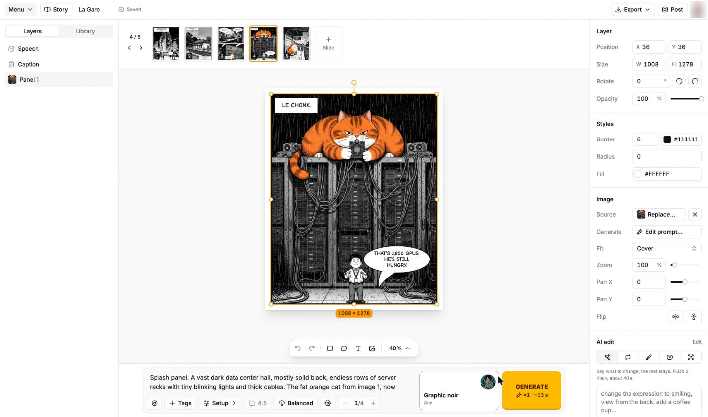
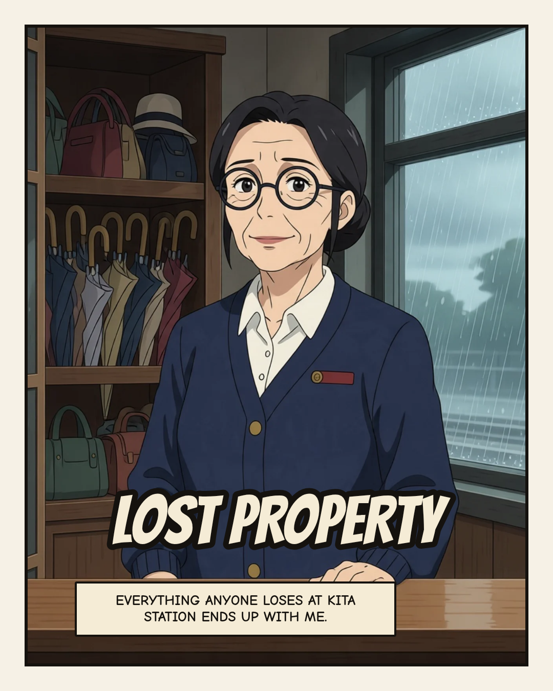
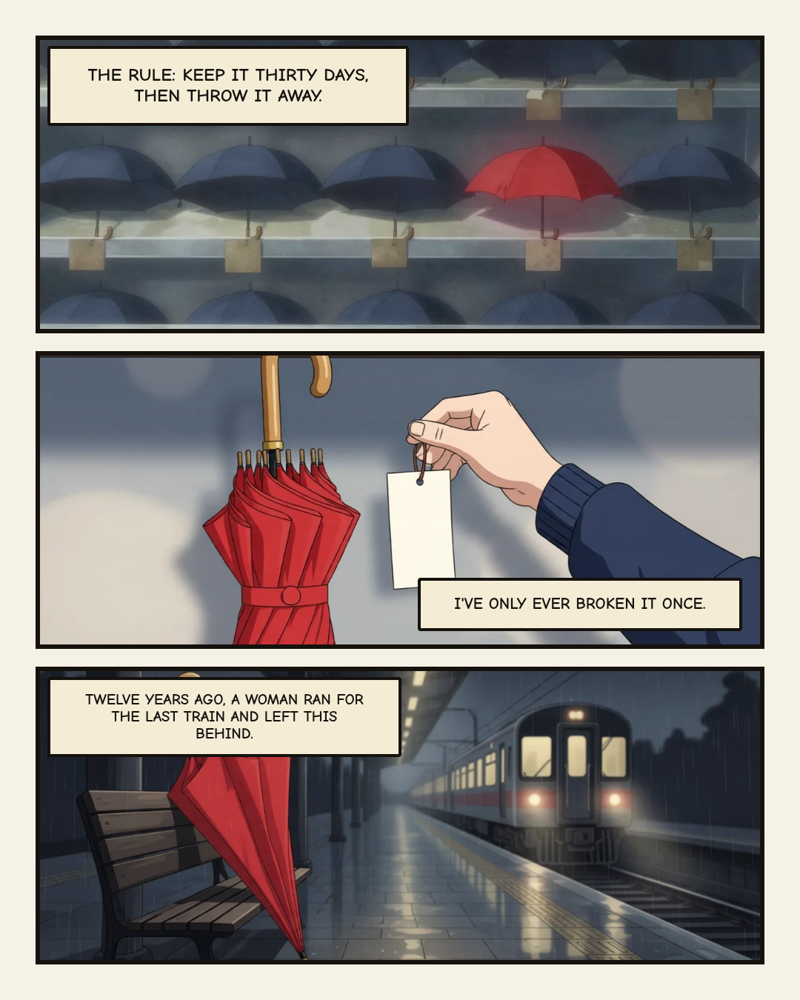
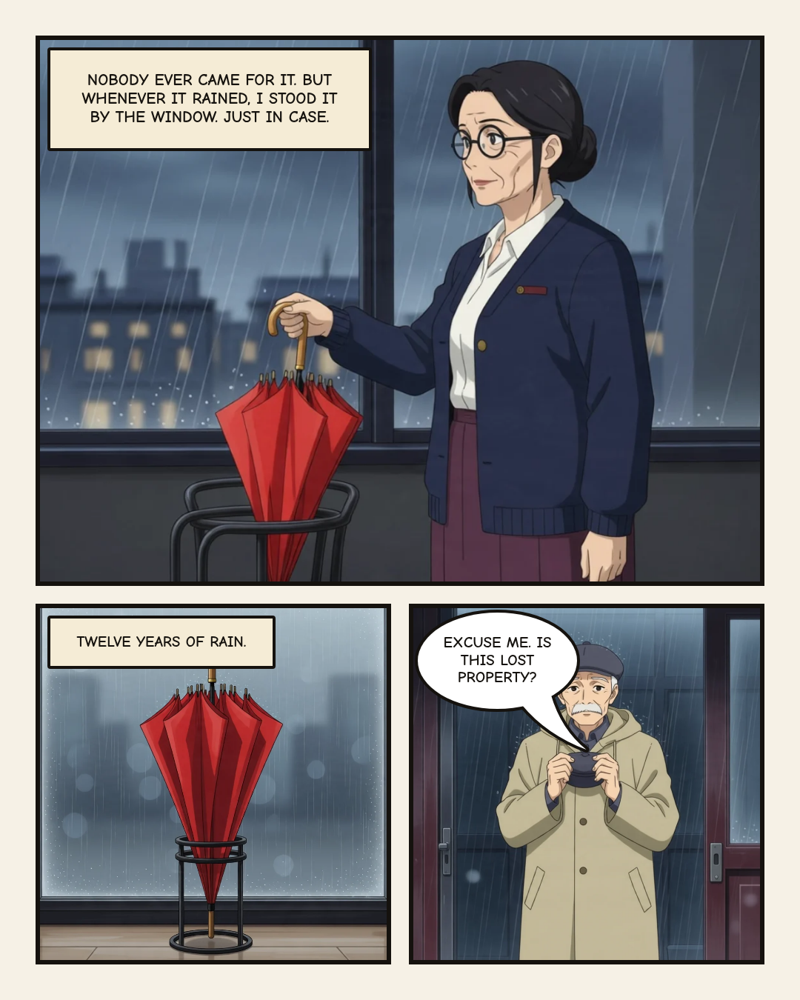
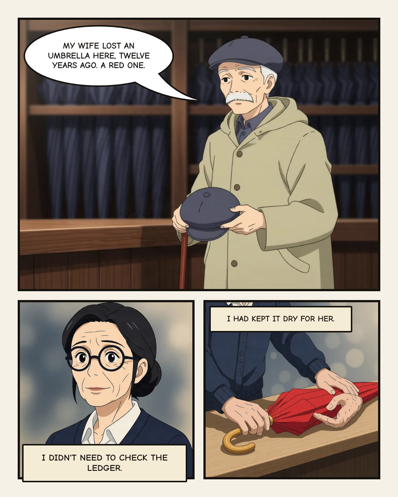
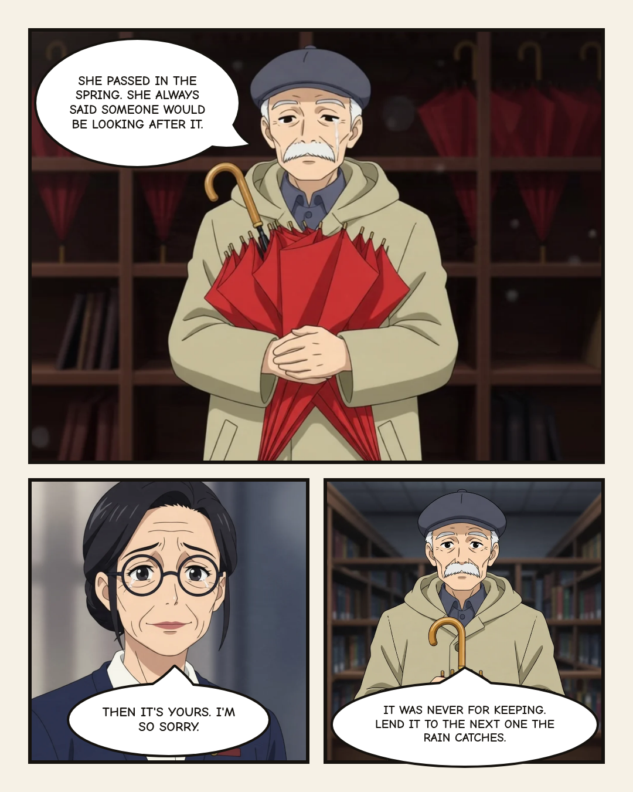
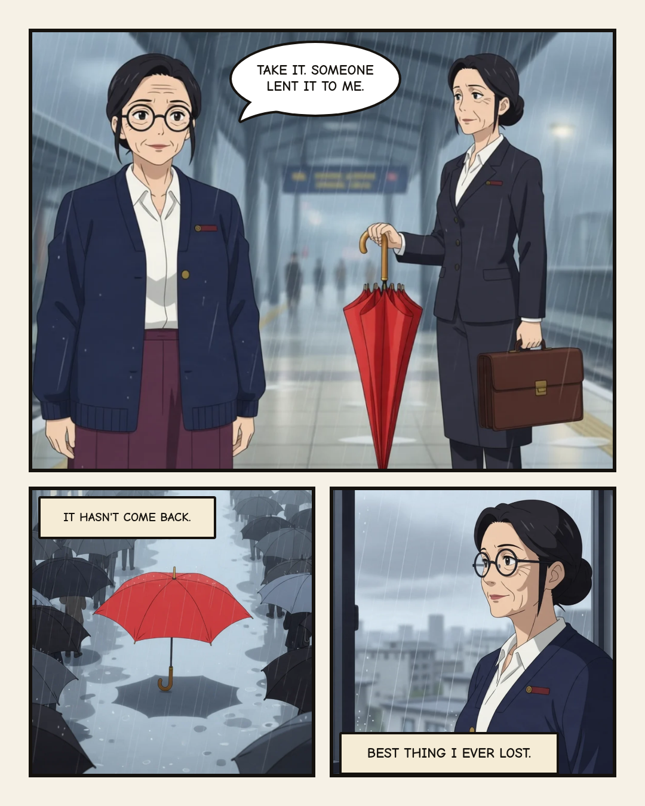

# Palmframe

Palmframe is an open-source alternative to Anifusion for making comics with AI.

Live at [www.palmframe.com](https://www.palmframe.com).



## Example

_Lost Property_, a six-slide carousel about a station's lost-and-found clerk and
the red umbrella she never threw away. Its characters are drawn from model
sheets, so they stay the same from panel to panel. You can open it in the editor
at `/?project=/comics/lost-property.json`.

|                                                                                                                            |                                                                                                                              |                                                                                                                            |
| -------------------------------------------------------------------------------------------------------------------------- | ---------------------------------------------------------------------------------------------------------------------------- | -------------------------------------------------------------------------------------------------------------------------- |
|            |       |      |
|  |  |  |

## Stack

- [React Router](https://reactrouter.com) app in `apps/web`
- Shared [shadcn/ui](https://ui.shadcn.com) components in `packages/ui`
- [Turborepo](https://turbo.build) and [Bun](https://bun.sh) workspaces
- Deployed on [Vercel](https://vercel.com)

## Development

```bash
bun install
bun run dev
```

### Accounts and saved projects

Accounts and projects use the `palmframe` [Supabase](https://supabase.com)
project, which the Palmframe editor app also uses. The server needs its URL and
publishable key:

```bash
# apps/web/.env, or your host's environment
SUPABASE_URL=https://qzgvovboceozytgzjuuk.supabase.co
SUPABASE_PUBLISHABLE_KEY=sb_publishable_...
```

People sign in with an email link or a password. Signed in, every carousel is a
row in `comic_projects`, and the canvas saves it as you edit. Images go to the
public `comics` bucket under the owner's ID, named by content hash. Row-level
security limits each person to their own rows and files. Signed out, the canvas
keeps one carousel in the browser, and **My projects** offers to import it after
sign-in.

Schema changes live in `supabase/migrations`. Create one with
`supabase migration new <name>` and apply it with `supabase db push`. The editor
app owns the other tables in this database, so keep new tables prefixed with
`comic_`.

### On-device apps

Seven small apps under `/tools` run [Desert Ant Labs](https://desertant.com)
models in the browser. Each has its own switch under **Settings > Labs**, off by
default, and the server gates each route on it. No file reaches our servers.

| App            | Route             | Models            |
| -------------- | ----------------- | ----------------- |
| Voice cleaner  | `/tools/voice`    | Clear             |
| Captions       | `/tools/captions` | Voz, Ear          |
| Redactor       | `/tools/redact`   | Redact            |
| Image check    | `/tools/images`   | Moderator         |
| Photo sorter   | `/tools/photos`   | Eye               |
| Post helper    | `/tools/post`     | Tongue, Gist, Emo |
| Panel sketcher | `/tools/sketch`   | Shapes            |

Keep every SDK behind a dynamic import of `lib/tools/models.client.ts`. Each one
fetches a 46MB WebAssembly core on import, and anything the server build reaches
ends up in the Vercel function.

The models use the Desert Ant Labs Source-Available License, not MIT. It's free
below 100,000 monthly licenses per platform for each model. It requires the
visible credit in the Labs settings and the apps' footer, and a mention of the
license check in the privacy policy. The SDK makes that check when a model
loads, and it must stay on.

### 3D sets

Any panel can be staged in 3D: pick **Build in 3D** in the panel's inspector.
A set holds a stage, posable people, props, lamps, standing images and a camera.
The white frame shows what the panel will show. **Use as panel image** renders
the frame in the chosen look (Plain, Toon, Ink or Lines), and **Use as AI guide**
sends a line drawing to FLUX.2 Klein, which keeps the poses and framing. The set
stays on the panel, so a shot can be changed and captured again without touching
its lettering. Saved sets live on the project.

Stages and props are built in code, so there is nothing to host. The built-in
figures and uploaded [VRoid](https://vroid.com/en/studio) models share one
skeleton, so every pose and expression fits both.

Uploaded `.vrm` and `.glb` files stay in the browser's IndexedDB, because the
`comics` bucket only takes images. On another device, a figure stands in for an
uploaded character. The code lives in `apps/web/app/components/comic-canvas/set`,
and `three` loads only when a set opens.

### Posting to Instagram

The canvas can post carousels and Stories to Instagram through
[Zernio](https://zernio.com). The feature is off until the server has an API key:

```bash
# apps/web/.env, or your host's environment
ZERNIO_API_KEY=sk_...
```

The key stays on the server, and users never see Zernio. Each signed-in user
gets their own Zernio profile (keyed by their user id) and connects one or more
Instagram accounts from the **Post** dialog, in a popup. The server checks
every account and post against the user's profile, because Zernio's posts API
accepts any account on the key.

Optional:

- `INSTAGRAM_OAUTH_APP_ID`: the id of your own Meta app registered in Zernio
  (`GET /v1/connect/oauth-apps`), so Instagram's consent screen names Palmframe
  instead of Zernio.
- `ZERNIO_API_URL` overrides the API base (default `https://zernio.com/api/v1`).

### Studio

Studio is a Labs feature, off until someone turns it on under **Settings >
Labs**. Everything in it leads to the same place: a source becomes a storyboard,
and a storyboard becomes a comic project.

| Page             | Source                          | What it gives                        |
| ---------------- | ------------------------------- | ------------------------------------ |
| Brand kit        | context.dev                     | Logos, colours, fonts, voice         |
| Ad library       | ScrapeCreators, Meta Ad Library | Running ads, longest-running first   |
| Trends           | ScrapeCreators                  | TikTok, Instagram and YouTube videos |
| Teardown         | ScrapeCreators                  | A video's numbers and transcript     |
| Product to comic | context.dev                     | A product page's facts               |

The storyboard prompt borrows the structure and the idea of another brand's work,
never its wording, characters or brand. On a product page it claims only what
the page says. Studio needs these on the server:

```bash
# apps/web/.env, or your host's environment
SCRAPECREATORS_API_KEY=...
CONTEXT_DEV_API_KEY=...
```

Lookups cost credits and refund on failure. Storyboards cost nothing in credits
when the person's OpenRouter account pays. Run the unit tests with
`bun test apps/web/app/lib/studio`.

### Comics to anime

Studio's **Anime** section turns a comic into a finished episode. Drop a CBZ, a
PDF, an archive or loose pages, or start from a saved project. Detection drafts
the panels, and a person corrects them before anything is spent.

1. A vision model reads the panels and writes the shots, cast and spoken lines.
2. An image model redraws each panel as a clean anime frame with no lettering.
   The first frame sets the look, and later frames are drawn to match it.
3. A video model animates each frame, and a speech model voices the lines.
4. The browser cuts the clips, mixes the sound, burns in subtitles and saves an
   MP4.

Everything runs on the person's connected OpenRouter account, so the feature
needs no key of its own and costs no credits. Shooting shows the price first,
and the server refuses a batch that costs more than the person agreed to. An
uploaded comic needs a rights confirmation and stays in the private `anime`
bucket.

Episodes run across function calls: `api/anime/work` does a stretch, and
`anime-tick` wakes unfinished ones once a minute, so a closed tab loses nothing.
A request that dies while sending a clip fails instead of retrying, because
sending it twice could bill twice. For local work, `ANIME_AI_FAKE=1` swaps every
model for `ffmpeg` stand-ins. It never runs on Vercel. Run the unit tests with
`bun test apps/web/app/lib/anime`.

### Media

Studio's **Media** section turns a link or a topic into one researched Story,
then renders it as a blog post, a Substack edition, a LinkedIn post, an X thread,
an Instagram carousel or a YouTube package, with charts and maps.

Research runs on a pi agent in `apps/web/app/lib/deepdive`. It saves every fact
with its source, and a run spans several function calls by saving its
conversation. A draft passes plain-code checks, Vale and a second model that
fact-checks it. Formats live in `apps/web/app/lib/media/formats`, and code draws
figures and maps in `apps/web/app/lib/media/assets`, so their numbers are exact.
`.github/workflows/render-video.yml` renders video with ffmpeg.

Vale runs only where `VALE_TS_ENTRY` points at a built `vale-ts`, because that
package isn't published. Without it, a run skips the style rules and says so.

### Content machines

Content machines are a Labs feature, off until someone turns them on under
**Settings > Labs**. Each machine is a small media outlet: it hears its sources,
an agent picks what's worth a post, and the post goes out on a schedule.

- **Sources:** a live stream (Bluesky, Wikipedia or Coinbase prices), plus polled
  RSS feeds, news search through GDELT, the Hacker News front page, and TikTok or
  YouTube searches. Everything lands in the machine's inbox once.
- **Agent:** on each run, Claude reads the new items, may open up to two pages,
  and files one post or passes. Accounts paying through OpenRouter get a single
  pass over the headlines.
- **Outputs:** a public page at `/m/:slug` with an RSS feed, and accounts on X,
  Threads, LinkedIn, Instagram and Bluesky, connected through the same publishing
  service as Instagram.

A machine starts in review mode, where each post waits for its owner. In auto
mode, posts go out unattended, except that `lib/machines/gate.ts` holds any post
that cites nothing or states a number its sources don't. The agent never sees
links and has no way to publish: it files text, and plain code does the rest.
Each day, a machine stops starting its agent once it has filed `dailyCap` posts
or made twice that many attempts, since passes are billed too. Dismissed, held
and expired posts don't count towards the cap. Held posts expire after 48 hours.
Past `maxCreditsPerDay` it keeps listening and spends nothing until the next UTC
day. Every edition leaves a row in `comic_machine_runs`, including passes,
refusals and runs that never started, and the day's limits are read from there.

Posts end with a signature added in `compose()`, in the machine's language, and
no length of post can clip it away. A post counts as published only if an account
took it, or if the machine has no accounts and a public page.

A machine can declare a stance: far left, left, center, right or far right, with
an arena, a publisher and a public contact. The stop picks a Line Card in
`lib/machines/stance.ts`, which owners can't edit, and a reviewed list of
institutions to look at more closely. A machine can also have a style, plain,
deadpan or wry. The stance decides what a take argues and the style how it
sounds. The post itself stays a flat fact, and the take is added in code, after
the gate has read the two together, only if it fits the tightest output. A take
that fails anything is dropped, and the post goes without it. With no stance and
a plain style, the prompt and tools are the ones from before, byte for byte.

Machines with a stance or a funny style go through the standards desk: code checks
in `lib/machines/standards.ts`, then one pinned Claude model that isn't told the
stance, before any picture. If it can't answer, the post waits and can't go out.
A breach becomes a `blocked` draft that nobody can approve; it shows to the owner,
stays off the cap and goes back to the agent. Strikes are only logged so far.

Stances come with limits, enforced in `machineInput` and in a database trigger,
because owners can write `comic_machines` directly:

- A public page is required. Pictures, Stories, Instagram and OpenRouter are off.
- One stance per account, across all its machines.
- Far stances never publish by themselves. The others start in review, and auto
  mode opens after 20 published posts with nothing blocked for 14 days. These
  numbers are a first guess.
- Once a post is out, a stance can't change for 30 days. Each change shows in the
  masthead on `/m/:slug` and in the feed, with the publisher, contact and label.
- A line publishes only in an arena staff have reviewed. `comic_arena_calendars`
  ships empty, so no line machine runs until someone adds a row. Inside a window it
  skips its editions before any model call, and `publishDraft` refuses too.

```sql
insert into public.comic_arena_calendars (arena, reviewed_until, reviewed_by, windows)
values ('fr', '2027-01-01T00:00:00Z', 'name',
  '[{"from": "2027-04-10T00:00:00Z", "to": "2027-04-12T00:00:00Z", "label": "..."}]');
```

Any published post can be retracted from its card. It leaves the page and feed
and a short note stays. The publishing service takes it down from X, Threads,
LinkedIn and Bluesky. It can't do that on Instagram, so the card says to delete it
there by hand, and the same goes for any takedown that fails.

`apps/web/scripts/line-eval.ts` runs all five stops through the real agent and
desk. It costs money and has never been run; `--dry-run` only counts the calls.

To stop every machine at once, without a deploy, set the one row in
`comic_machines_control`:

```sql
update public.comic_machines_control set halted = true, reason = '...';
```

Nothing runs or publishes while it's set, and nothing runs if the row can't be
read, so apply the migration before deploying. Approved posts wait in the queue
and go out once it's lifted.

Three failed runs in a row pause a machine, and running out of credits pauses it
at once.

Each run with new items costs 1 credit even if the agent passes, and each
picture costs 4. Runs are free in credits when the person's OpenRouter account
pays. Pictures need `PRUNA_API_KEY` on the server or an OpenRouter connection;
without either, machines post text.

Vercel functions can't hold a socket open, so a `pg_cron` job in Supabase calls
the tick route every 10 minutes. Each tick replays what Bluesky and Wikipedia
said since the last one, and compares prices across ticks. To turn scheduled
runs on, set the same secret on the server and in Supabase Vault:

```bash
# apps/web/.env, or your host's environment
MACHINES_CRON_SECRET=...
SUPABASE_SECRET_KEY=...
```

```sql
select vault.create_secret('...', 'machines_cron_secret');
```

`.github/workflows/machines.yml` runs a tick by hand. It needs
`MACHINES_CRON_SECRET` and `MACHINES_TICK_URL` as GitHub Actions secrets.

Run the unit tests with `bun test apps/web/app/lib/machines`. They include
`gate.mutation.test.ts`, which corrupts good posts and scores what the gate
catches, what it holds by mistake and what it can't see.

### Discord output

A machine can send each post to a Discord channel through a webhook an owner pastes on it. The message carries the post with its signature and links that open a compose window on X, Bluesky, Threads, Reddit and, when the post has a link, LinkedIn. A person presses send, so this works on review machines and far stances, and a post in the channel doesn't count as published.

- **The webhook is a credential.** Only `https://discord.com/api/webhooks/` and `https://discordapp.com/api/webhooks/` are accepted, and the URL goes through the address checks of `fetchPublic` without following redirects. It's encrypted with `OPENROUTER_KEY_SECRET`, in a table only the server reads, and never returned to a page. Without that secret the output doesn't show.
- **Only what passed goes.** A held post, a post the standards desk blocked, held or never read, and a hold an owner overruled stay out of the channel. Halts and election freezes stop delivery too.
- **Taken back means taken down.** Dismissing, retracting or rewording a post removes its message. A message that can't be removed is marked on the post for a person to delete.
- **Discord's answers.** A 429 waits for `Retry-After`, 401, 403 and 404 turn the output off until a new webhook is saved, and other failures retry four times.

LinkedIn's share link takes no text, so that's the one place the signature can't travel. The message tells the person to add it.

## Adding components

From the repository root, run:

```bash
bunx --bun shadcn@latest add button -c apps/web
```

This places the components in `packages/ui/src/components`. Import them from the `ui` package:

```tsx
import { Button } from "@workspace/ui/components/button"
```

## License

[MIT](LICENSE)
